#   
# Lab 3.4: Training a Machine Learning Model  
  
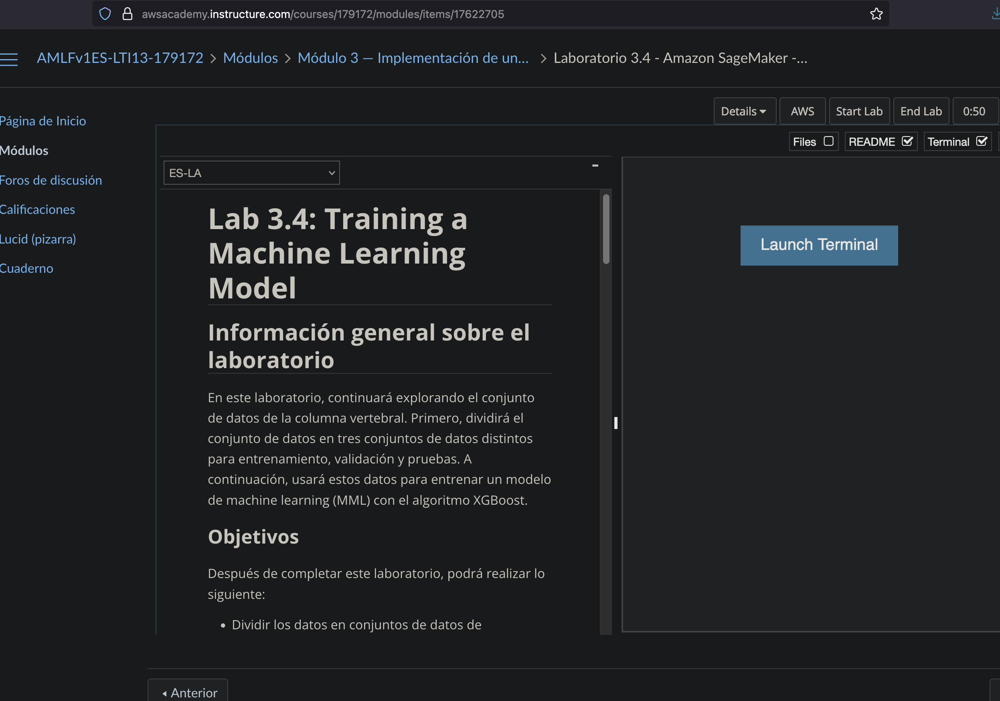  
  
  
  
Seleccionear el servicio :   Amazon SageMaker AI  
  
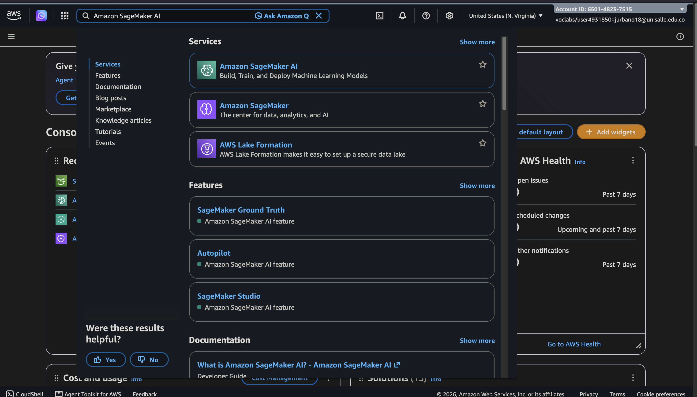  
  
  
  
Seleccionamos notebook  
  
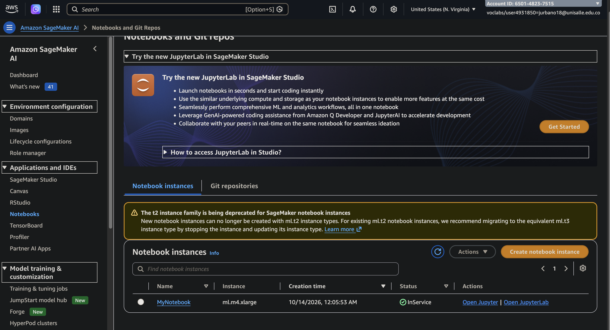  
  
  
  
  
  
  
  
  
Revisamos los archivos   
  
Inicializamos el reposo  
  
Crear carpeta pantallazos  
Inicializar el repositorio de git   
  
Configurar usuario GitHub  
  
  
Configuration previa  en el repositorio  
  
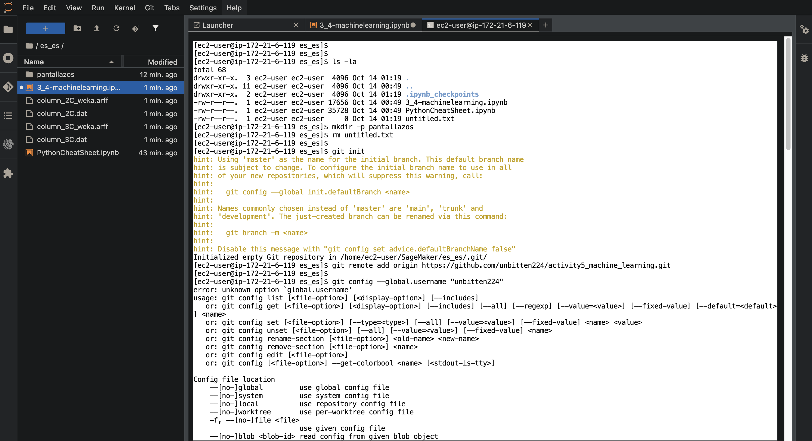  
  
  
  
Luego  
Crear git branch   dev_jurbano18  
  
Realizamos el primer comió con los archivos actuales  
3_4-machinelearning.ipynb  
PythonCheatSheet.ipynb  
  
Primer commit “initial commit”  
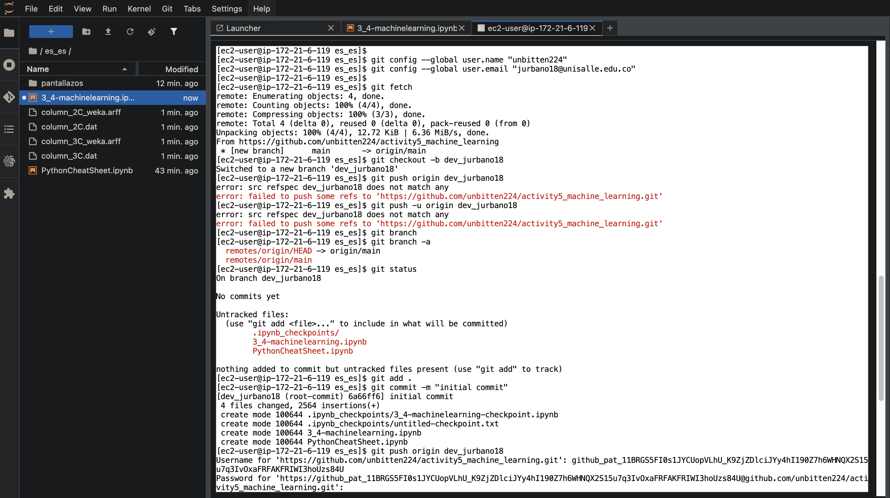  
  
  
  
Instalamos dependencias  scipy  
  
  
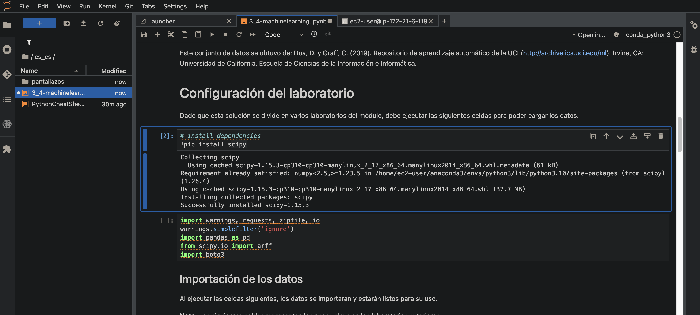  
  
  
Importar dependencias  
  
descargar el dataset de machine-learning-databases  
  
Al lado derecho se ven los archivos  
  
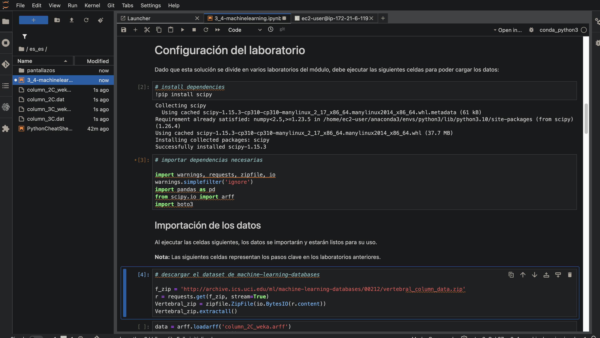  
  
  
Se descarlos  los archivos en el directorio actual   
  
column_2C.dat  
column_2C_weka.arff    
column_3C.dat    
column_3C_weka.arff  
  
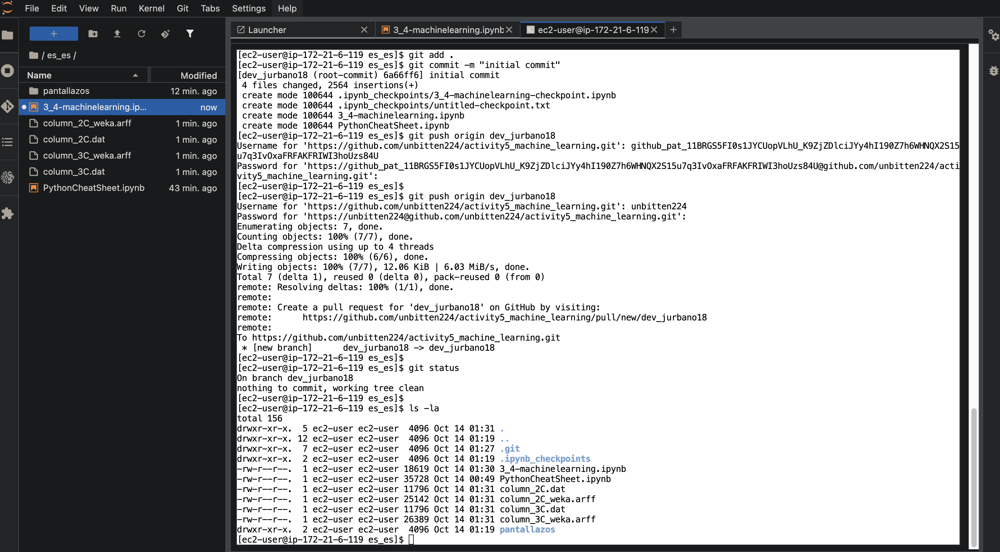  
  
  
  
Proceso de importación  
  
# descargar el dataset de machine-learning-databases  
  
# se encarga de cargar un archivo de datos (column_2C_weka.arff)   
# en formato ARFF y transformarlo en una tabla de tipo dataframe  
  
  
# Crea un diccionario de mapeo que relaciona los valores de texto originales Abnormal, Normal   
# con los número 1, 0  
  
  
# Aplica ese diccionario sobre la columna llamada class del DataFrame (df)  
  
Para que se  
  
El algoritmos de aprendizaje XGBoost no pueden entrenarse directamente utilizando etiquetas de texto así que necesitan que las clases estén representadas en formato numérico binario  
  
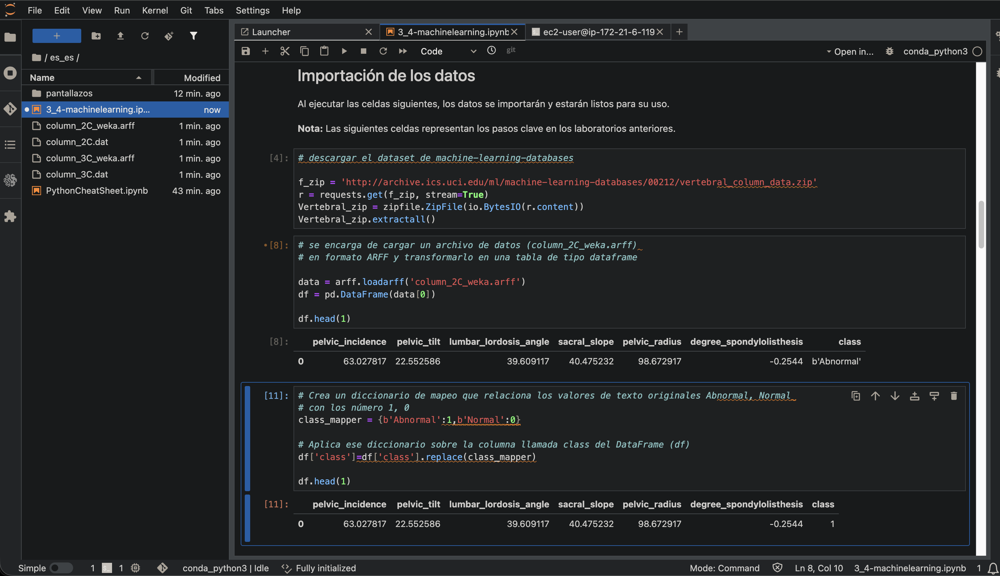  
La diferencia entre ambos estados del DataFrame es la conversión de la etiqueta de clase de texto a formato numérico en la columna class  
  
  
  
  
paso 1 Exploramos los datos  
  
# conocer las dimensiones de un DataFrame, devuelve el número de columnas y filas  
  
#  muestra las columnas del dataframe  
  
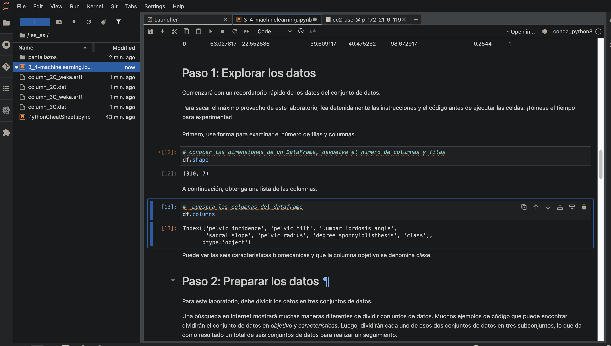  
  
  
En esta parte antes de pasar a la preparación y división de los datos lo que se hace es que garantiza que la estructura del conjunto de  datos cargado coincida con lo esperado por el modelo  
  
  
  
Ahora subimos al repositorio los archivos descargados del dataset y cargamos los comentarios y actualización del laboratorio 3_4-machinelearning.ipynb  
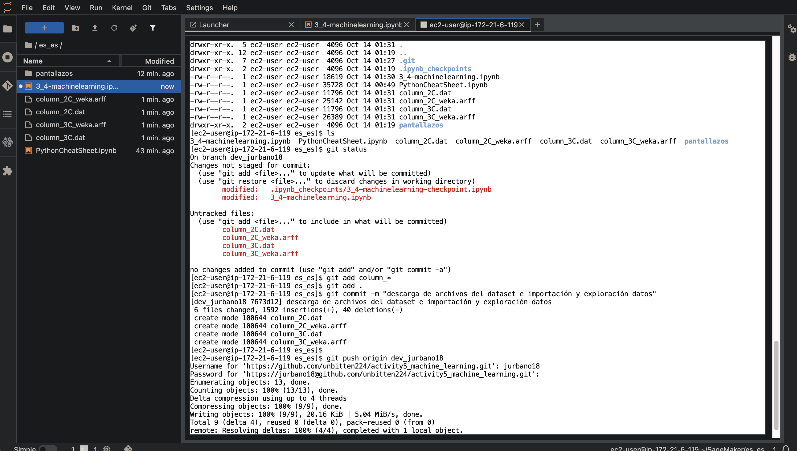  
  
  
  
  
Paso 2: Preparar los datos  
  
# vemos como estaba antes de organizar el dataframe, la columna class de última columna  
  
# luego se reorganizar las columnas del DataFrame, moviendo  la columna de clase a la primera posición   
# la columna de más a la izquierda  
  
# finalmente se muestra las columnas del dataframe donde muestra class como la primera columna  
  
¿Para que esto?
Cuando se utiliza **XGBoost en Amazon SageMaker** al utilizar el formato de datos CSV requiere que la columna class que el modelo debe predecir se encuentre en la **primera columna** del archivo.   
Si está en otra posición entonces el algoritmo la interpretará mal  
  
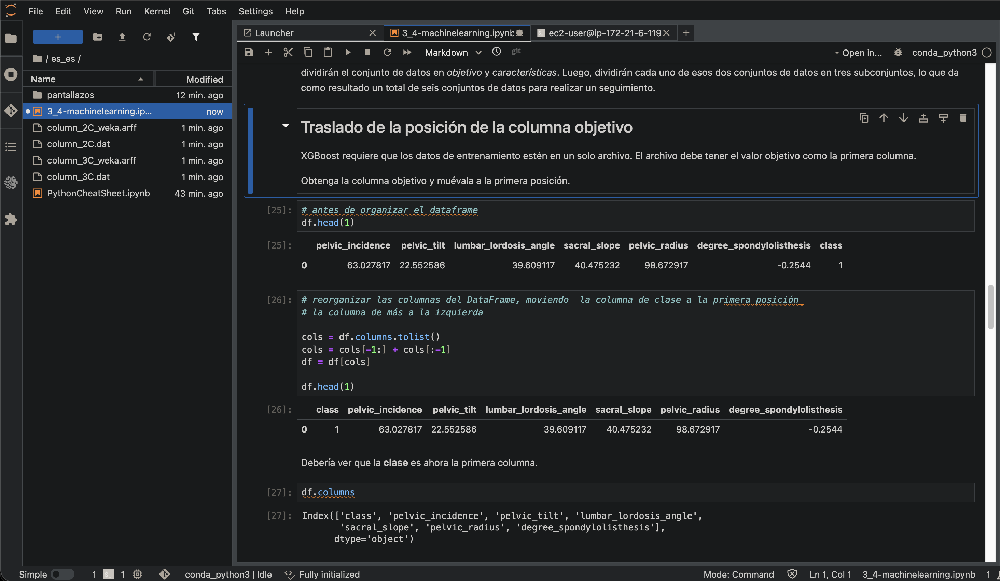  
  
  
  
  
División de los datos  
  
Aquí empezamos por instalar la dependencia  *scikit-learn*  
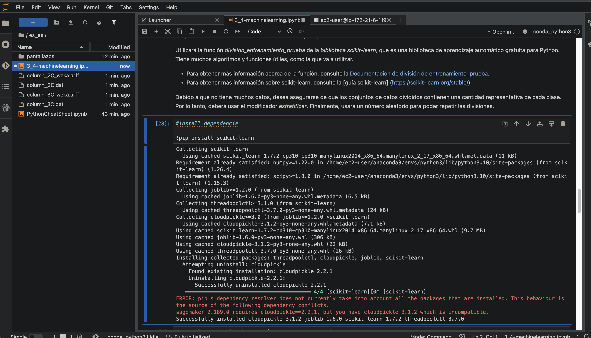  
  
  
A continuación, divida el conjunto de datos *probar_y_validar* en dos partes iguales.  
  
  
  
Para qué   
  
Realiza una **división **de los datos donde garantiza que ambas mitades conserven  la misma proporción equilibrada de pacientes sanos y enfermos y asegurando la reproducirlos del experimento mediante la semilla  
  
Al final tuvo como resultado  
  
**Conjunto de entrenamiento (train)**: 168 pacientes anormales (1) y 80 pacientes normales (0).  
**Conjunto de prueba (test)**: 21 pacientes anormales (1) y 10 pacientes normales (0).  
**Conjunto de validación (validate)**: 21 pacientes anormales (1) y 10 pacientes normales (0).  
  
  
  
  
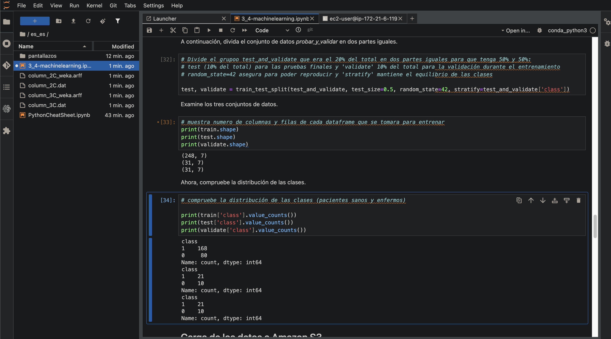  
  
  
  
Carga de los datos a Amazon S3  
  
  
# convertir DataFrames a formato CSV y subirlos directamente a la ruta del bucket en Amazon S3  
  
¿Para qué?  
 XGBoost de AWS no lee archivos locales en el laboratorio  sino que es requisito que los datos estén almacenados  en la nube (S3) en formato CSV plano sin encabezados ni índices para evitar saturar el disco virtual con archivos temporales innecesarios  
  
  

  
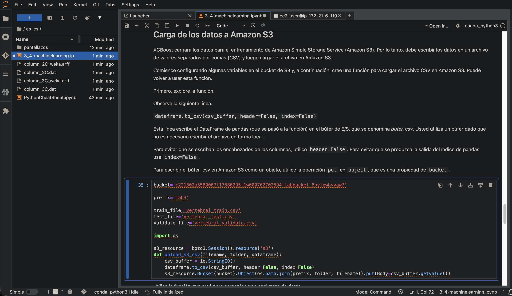  
  
  
  
  
  
  
Luego se cargan en el bucket s3  
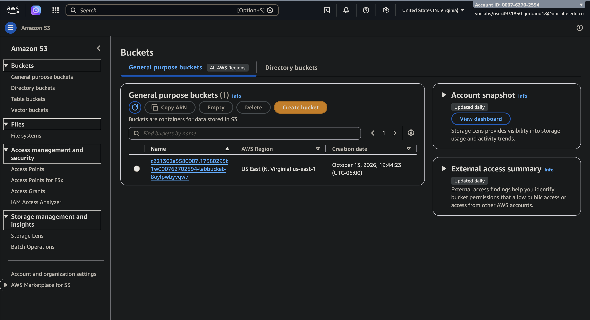  
  
3 carpetas test, train y validate  
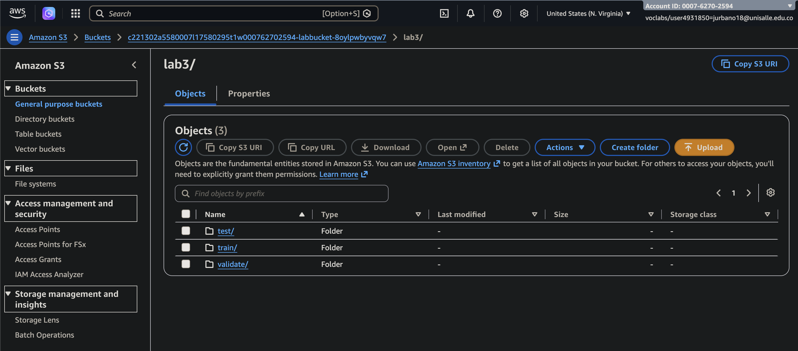  
  
En cada carpeta hay un archivo llamado  
* vertebral_train.csv  
* vertebral_test.csv  
* vertebral_validate.csv  
  
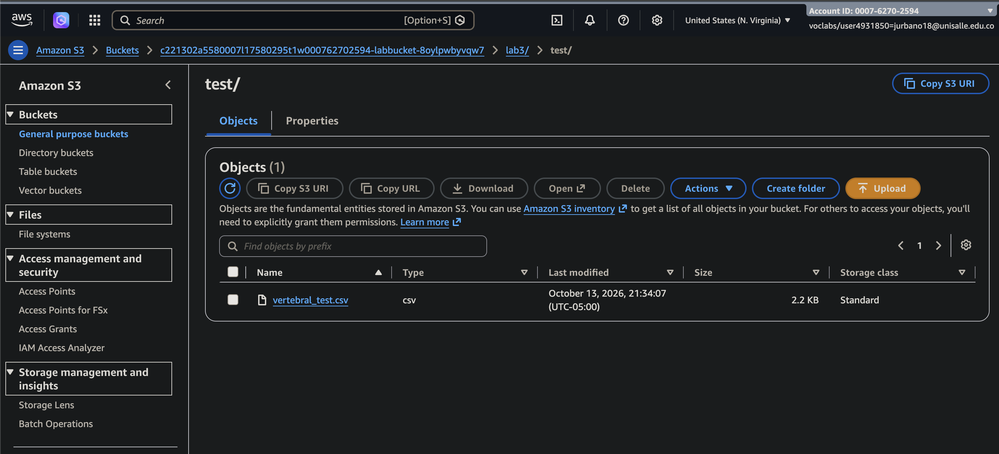  
  
  
  
Subo los cambios al reposiorio hasta la carga de datos s3  
  
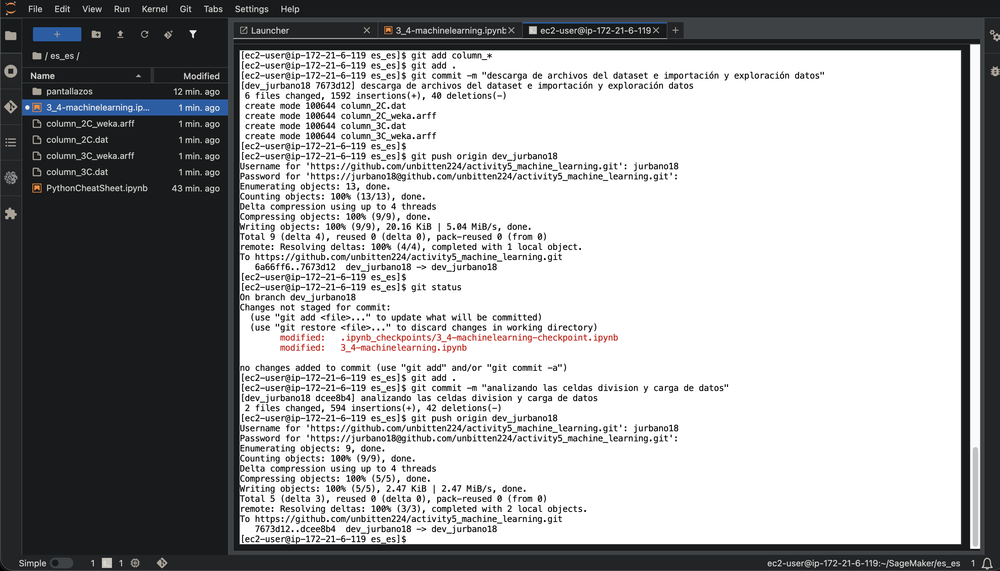  
  
  
  
  
  
Paso 3: Entrenar el modelo  
  
  
Para qué?  
Le indica al servicio SageMaker qué motor de aprendizaje automático preconfigurado debe preparar y descargar para entrenar tu modelo  
  
  
Esto se hace para **crear y configurar el "entrenador" **que utilizará Amazon SageMaker para construir el modelo  
* **Utiliza:** El algoritmo XGBoost que preparado antes.  
* **Dónde guardar el resultado:** En una carpeta específica de tu S3 (output)  
* **Qué equipo usar:** Una computadora virtual potente en la nube  
  
  
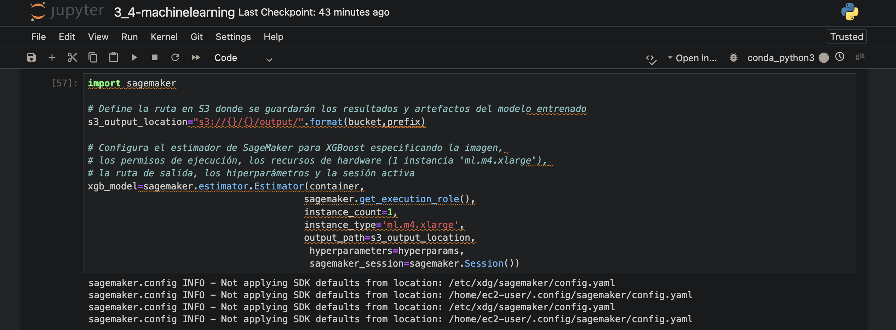  
  
  
Finalmente  
  
Se conectan los archivos de entrenamiento y validación que subiste a S3 para que la nube sepa de dónde sacar la información  
  
Al ejecutar esta orden, la computadora virtual en la nube descarga los datos y luego procesa el aprendizaje de XGBoost y muestra el avance paso a paso  
  
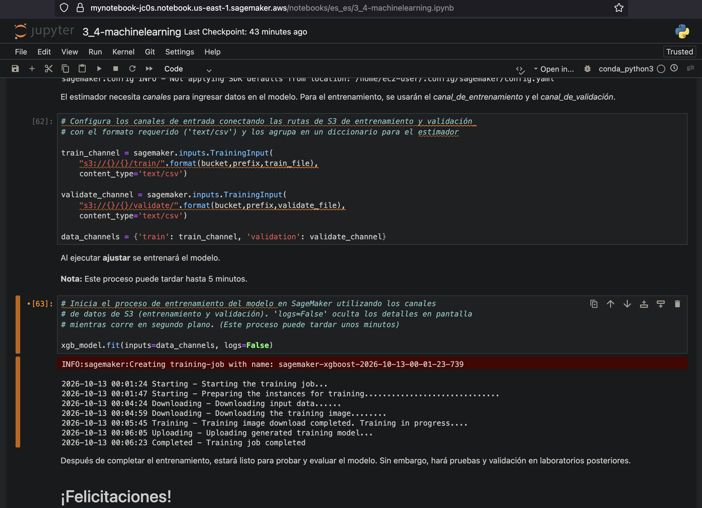  
  
